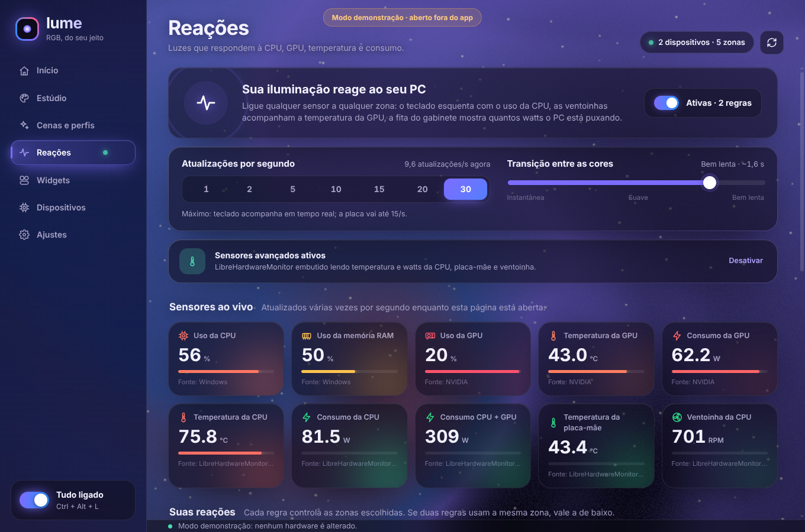

# Lume RGB

Controle de iluminação RGB para Windows (MSI MS-7E30 + teclado X68HE) por USB/HID direto,
com interface em WebGPU (biblioteca [Shaders](https://github.com/shader-effects-inc/shaders)),
widgets na área de trabalho para ligar/desligar tudo, ícone na bandeja e atalho global
<kbd>Ctrl</kbd>+<kbd>Alt</kbd>+<kbd>L</kbd>, **Reações** (CPU, RAM, GPU, frequência, disco, rede, temperaturas, watts e ventoinha controlando
qualquer zona, 1–30 atualizações/s com suavização e gradiente HSV;
transições temporais em canais compatíveis, com uso do canal ao vivo do teclado apenas após confirmação visual;
reconexão automática de dispositivos; botão "Copiar diagnóstico";
LibreHardwareMonitorLib embutido como opção experimental) e atualização automática a partir do branch `main`.

Na 3.8, CPU e placa-mãe são lidas em processos separados, com comunicação assíncrona,
tempo limite e validade individual das leituras. Os quatro sensores avançados foram
validados neste PC por 90 segundos. A análise do aplicativo de fábrica fornecido
identificou o protocolo correto do X68HE: uma cor RGB pelo comando 0x0E, após selecionar
Screen color. Os antigos pacotes 0x0F eram ignorados. O usuário confirmou uma transição
física de 30 segundos com cores intermediárias, sem apagar ou piscar, em 12/10/2026
(dispositivo 2472, firmware 0x0303). O app mantém o canal apenas após confirmação visual
e deixa a última cor num efeito nativo ao sair. Não envia mais os comandos 0x14/0x94,
cuja interpretação como ativação de LampArray não era sustentada pelo driver.

- `source/` — app C# (.NET Framework 4, C# 5): serviço de hardware, widgets, bandeja, janela WebView2.
- `ui/` — interface HTML/CSS/JS; abrir `ui/index.html` num navegador mostra o modo demonstração.
- `lib/` — DLLs do WebView2 SDK e do LibreHardwareMonitorLib (+ dependências) usadas na compilação e copiadas para o app.
- `tools/package.sh` — compila com Mono (`mcs -langversion:5`), roda os testes sem hardware e gera `dist/LumeRGB.zip`.
- No Windows: `COMPILAR.bat` (usa `source\build.rsp`, as mesmas opções do atualizador).
- O app instalado guarda o commit em `version.json`; ao abrir, compara com a `main` via API do GitHub.

Licença do app: GPL-2.0-or-later (`LICENSE-GPL-2.0.txt`); veja `ATRIBUICOES.txt`.
