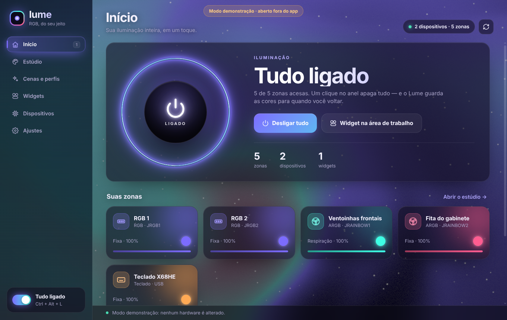
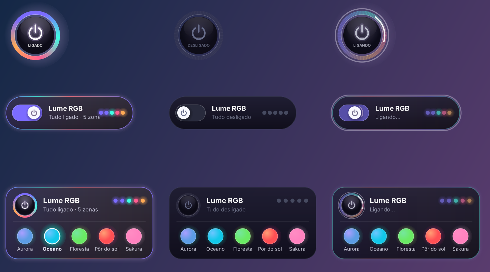

# Lume RGB

Controle de iluminação RGB para Windows (MSI MS-7E30 + teclado X68HE) por USB/HID direto,
com interface em WebGPU (biblioteca [Shaders](https://github.com/shader-effects-inc/shaders)),
widgets na área de trabalho para ligar/desligar tudo, ícone na bandeja e atalho global
<kbd>Ctrl</kbd>+<kbd>Alt</kbd>+<kbd>L</kbd>.

- `source/` — app C# (.NET Framework 4, C# 5): serviço de hardware, widgets, bandeja, janela WebView2.
- `ui/` — interface HTML/CSS/JS; abrir `ui/index.html` num navegador mostra o modo demonstração.
- `lib/` — DLLs do WebView2 SDK usadas na compilação.
- `tools/package.sh` — compila com Mono (`mcs -langversion:5`), roda os testes sem hardware e gera `dist/LumeRGB.zip`.
- No Windows: `source\build.ps1`.

Licença do app: GPL-2.0-or-later (`LICENSE-GPL-2.0.txt`); veja `ATRIBUICOES.txt`.
